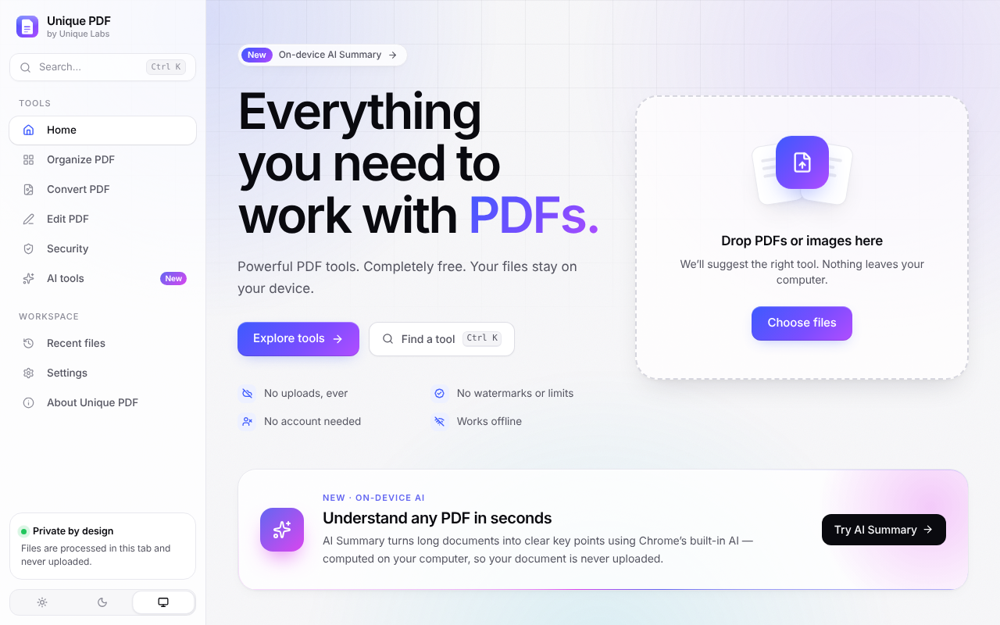
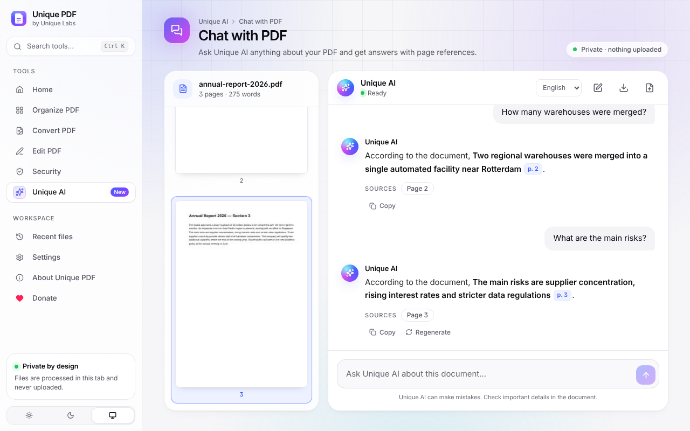
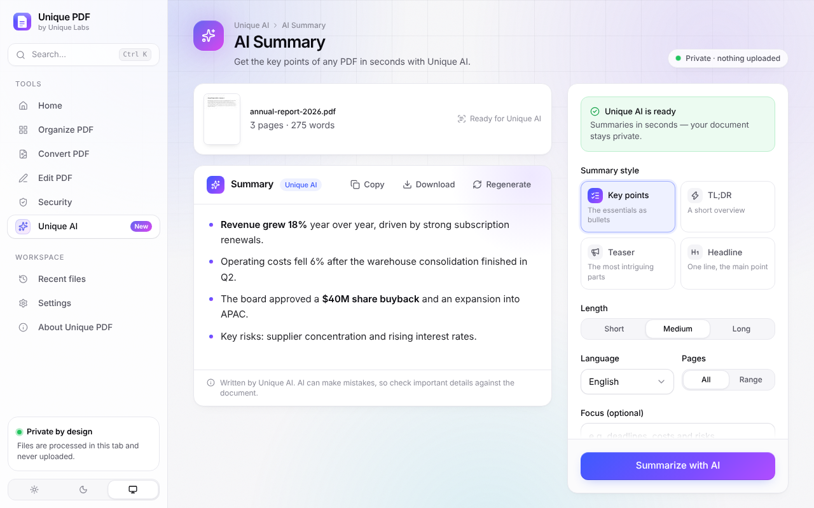
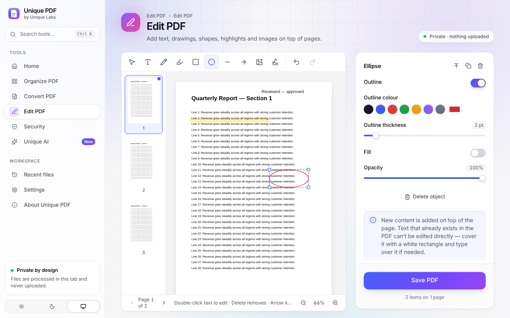

<div align="center">


<picture>
  <source media="(prefers-color-scheme: dark)" srcset="https://readme-typing-svg.demolab.com?font=Fira+Code&amp;weight=600&amp;size=22&amp;duration=3600&amp;pause=700&amp;color=FFB703&amp;center=true&amp;vCenter=true&amp;width=820&amp;height=48&amp;lines=Offline+PDF+tools+in+Chrome;Chat+with+any+PDF%2C+nothing+uploaded;Merge%2C+compress%2C+sign+and+redact;Unique+AI+by+Unique+Labs;Free.+No+account%2C+ads+or+watermark" />
  <source media="(prefers-color-scheme: light)" srcset="https://readme-typing-svg.demolab.com?font=Fira+Code&amp;weight=600&amp;size=22&amp;duration=3600&amp;pause=700&amp;color=6C2BD9&amp;center=true&amp;vCenter=true&amp;width=820&amp;height=48&amp;lines=Offline+PDF+tools+in+Chrome;Chat+with+any+PDF%2C+nothing+uploaded;Merge%2C+compress%2C+sign+and+redact;Unique+AI+by+Unique+Labs;Free.+No+account%2C+ads+or+watermark" />
  
</picture>

**Free PDF tools without subscriptions, watermarks or file uploads — by Unique Labs.**

<br/>


<br/>


<br/>

<a href="https://pdf.uniquelabs.org"></a>
<a href="https://chromewebstore.google.com/detail/ogajiapfmheeiadeflajlkikpfkoobfl"></a>
<a href="https://www.uniquelabs.org"></a>
<a href="https://github.com/fr-ost"></a>

<br/>

[Overview](#overview) · [Features](#key-features) · [Install](#getting-started) · [Usage](#usage) · [Privacy](#privacy) · [Docs](#documentation)

</div>

> Unique Labs — *Useful technology. Accessible to everyone.*
>
> Developed by [Shahriar Ahmed](https://www.shahriarahmed.net) at [Unique Labs](https://www.uniquelabs.org).

## ✨ Overview

Unique PDF is a Chrome extension (Manifest V3) that brings **20 PDF tools** into a full-tab application, including **Unique AI** by Unique Labs: **chat with any PDF** (answers link to the pages they come from) and **AI Summary**.

Every file is processed in your browser. Nothing is uploaded. There is no account, no quota, no watermark and no ads. Anonymous usage stats are optional and off unless you turn them on. It keeps working offline once installed.

Chrome 122 or later. Unique AI needs desktop Chrome 138+.

The precise behaviour of every tool is in [FEATURES.md](FEATURES.md).

## 🧰 Key features

| Category | Tools |
| --- | --- |
| **Organize** | Merge · Split (every page, ranges, equal parts, at selected pages) · Organize workspace (multi-file reorder/rotate/delete) · Rotate · Reorder · Delete pages · Extract pages |
| **Convert** | Compress (image optimisation, deduplication, clean-up; optional page rasterisation) · Images → PDF (JPEG, PNG, WebP, GIF, BMP, AVIF) · PDF → images (PNG/JPEG, 72–600 DPI, ZIP) |
| **Edit** | Editor (text, freehand, highlights, rectangles, ellipses, lines, arrows, images, undo/redo, zoom) · Sign (drawn vector signatures) · Watermark (text or image, opacity, rotation, position, tiling, behind content) · Page numbers |
| **Security** | Protect (AES-256) · Unlock (with the real password only) · Redact (true removal + automatic verification) · Metadata (view, edit, remove; XMP kept in sync) |
| **Unique AI** | Chat with PDF — ask anything; answers stream in with clickable page citations, sources and a page rail; follow-up questions, suggested questions, stop/regenerate, copy, export. AI Summary — key points, TL;DR, teaser or headline; long documents are summarised in parts. Where the AI model isn't available: labelled non-AI search and key-sentence summaries |

Also included:

- Drag and drop everywhere, including onto tool cards
- Password prompts for encrypted PDFs
- Progress with cancel
- Recent-task history (names and sizes only)
- Command palette (`Ctrl K` / `⌘ K`)
- Light, dark and system themes; all motion respects “reduce motion”
- Keyboard operation, a quick-access popup, and shortcuts (`Alt+Shift+P` opens the app, `Alt+Shift+U` opens the popup)
- A **Donate** page (crypto wallets with QR codes)
- In store installs, an occasional request for a 5-star rating — support without ads or paywalls

## 🖼️ Screenshots

<div align="center">

<table>
  <tr>
    <td width="50%" align="center">
      <picture>
        <source media="(prefers-color-scheme: dark)" srcset="store-assets/screenshots/07-home-dark.png" />
        
      </picture>
      <br/><sub>Home</sub>
    </td>
    <td width="50%" align="center">
      <picture>
        <source media="(prefers-color-scheme: dark)" srcset="store-assets/screenshots/08-ai-chat-dark.png" />
        
      </picture>
      <br/><sub>Chat with PDF</sub>
    </td>
  </tr>
  <tr>
    <td width="50%" align="center">
      
      <br/><sub>AI Summary</sub>
    </td>
    <td width="50%" align="center">
      
      <br/><sub>Editor</sub>
    </td>
  </tr>
</table>

</div>

## 🧪 Tech stack

| Layer | What this repo uses |
| --- | --- |
| Extension | Chrome Manifest V3. One permission: `storage`. Minimum Chrome 122. |
| UI | React 19, Tailwind CSS 4, Vite |
| Language | TypeScript, strict (`npm run typecheck`) |
| Read PDFs | PDF.js 6 (`pdfjs-dist`) for pages, thumbnails and text. Its scripting engine is not shipped. |
| Write PDFs | `@cantoo/pdf-lib` in a processing worker (one worker per job) |
| Tests | Vitest, Playwright, axe-core |
| Website | Static HTML generated from `scripts/website/`, deployed on Vercel |
| Optional stats | Cloudflare Worker and D1 in [`tracker/`](tracker/README.md). Off unless the user opts in. |

Requirements for development: **Node.js 22.13+** and **npm 10+**.

## 🚀 Getting started

### Install in Chrome (unpacked)

**Option A — prebuilt package (no tools needed).** `npm run package` writes a store ZIP to `release/unique-pdf-<version>.zip` (this version: `release/unique-pdf-1.3.0.zip`). The `release/` directory is not committed. If you already have that ZIP, extract it to a folder you will keep (for example `Documents/unique-pdf`), then follow steps 2–5 and select that folder.

**Option B — build it yourself.** Run `npm install` and `npm run build`. The extension is written to `dist/`.

1. Get the extension folder (Option A or B above).
2. Open `chrome://extensions` in Chrome (version 122 or later; Unique AI needs desktop Chrome 138+).
3. Turn on **Developer mode** (top-right toggle).
4. Click **Load unpacked** and select the extracted folder (Option A) or `dist/` (Option B).
5. The Unique PDF tab opens automatically on first install. Afterwards, click the toolbar icon (pin it from the puzzle-piece menu) or press `Alt+Shift+P`.

To update after rebuilding, click the reload icon on the Unique PDF card in `chrome://extensions`.

### Development

```bash
npm install
```

```bash
npm run dev
```

`npm run dev` serves the app at `http://localhost:5173/app.html` for fast UI iteration. In a normal page, Chrome extension APIs are unavailable, so settings and history fall back to `localStorage`.

To work against the real extension runtime, build continuously and reload the unpacked extension:

```bash
npm run watch
```

This writes a development build (with source maps) to `dist-dev/`. Load that folder unpacked.

| Script | Purpose |
| --- | --- |
| `npm run typecheck` | Strict TypeScript check |
| `npm run lint` | ESLint (TypeScript + React hooks rules) |
| `npm test` | Unit and component tests (Vitest) |
| `npm run test:e2e` | End-to-end tests in Chromium with the built extension (run `npm run build` first) |
| `npm run screenshots` | Regenerates Chrome Web Store screenshots in `store-assets/screenshots/` |
| `npm run icons` | Regenerates the PNG icons |

### Build, validate and package

```bash
npm run build
```

This copies the PDF.js runtime assets, type-checks, bundles with Vite into **`dist/`**, writes `THIRD_PARTY_NOTICES.txt` and runs `scripts/validate-build.mjs`. The build fails if:

- the manifest is not valid MV3, versions disagree, or referenced files/icons are missing;
- any permission other than `storage`, any host permission, content script or web-accessible resource appears;
- the CSP allows remote scripts or `unsafe-eval`, or network connections beyond the extension and the opt-in usage-stats tracker;
- any bundle contains `eval`, `new Function`, CDN or telemetry URLs, inline scripts, source maps, test fixtures, the PDF.js scripting engine, or pdf-lib outside the processing worker.

To create the Chrome Web Store upload:

```bash
npm run package
```

The ZIP is written to `release/unique-pdf-<version>.zip`. Submission steps and listing text are in [store-assets/STORE_LISTING.md](store-assets/STORE_LISTING.md). The version comes from `package.json` — bump it there before packaging a new release.

## ⚙️ Configuration

The extension has no environment file. Settings (theme, defaults, history, the save dialog) live in Chrome `storage` on the device.

`npm run website` regenerates `website/` from the extension. These names are optional overrides; values belong in the environment or in [`scripts/website/config.mjs`](scripts/website/config.mjs), never in a commit of secrets.

| Name | Used by | Meaning |
| --- | --- | --- |
| `SITE_URL` | `npm run website` | Public site address, no trailing slash. Default in config: `https://pdf.uniquelabs.org`. |
| `STORE_URL` | `npm run website` | Chrome Web Store listing URL. Default is the listing set in `scripts/website/config.mjs`. |

Before going live, set the site address and the store link, then rebuild. On Vercel, set the project's **Root Directory** to `website`, framework preset *Other*, and no build command.

The optional usage-stats worker in [`tracker/`](tracker/README.md) is a separate Cloudflare project:

| Name | Used by | Meaning |
| --- | --- | --- |
| `DB` | Cloudflare Worker binding | D1 database. The binding name must be exactly `DB`. |
| `STATS_KEY` | Cloudflare Worker secret | Optional. When set, the stats API requires this key. Do not commit the value. |

## 🧭 Usage

After install, Unique PDF opens in a tab. Later:

- Click the toolbar icon, or press `Alt+Shift+P`, to open the app.
- Press `Alt+Shift+U` to open the popup (nine quick tools, recent tasks, theme).
- Press `Ctrl K` / `⌘ K` for the command palette (tools, pages, theme).
- Drop files on the home screen or on a tool card.
- If another extension already uses a shortcut, change it at `chrome://extensions/shortcuts`.

**Unique AI** (chat and summaries) uses the AI APIs built into Chrome. The document text is processed in the browser and is never sent to Unique Labs or any server. On first use, Chrome downloads and manages the model itself (desktop Chrome 138+, about 22 GB free disk, and a capable GPU or 16 GB RAM). Where that model is not available, chat falls back to a labelled passage search and AI Summary falls back to a labelled key-sentence summary.

Passwords stay in memory only for the operation. Documents are not stored. Recent history, if you leave it on, keeps names and sizes only.

## 🗂️ Project structure

```
src/ai/            Unique AI: chat, summary, retrieval
src/features/      Tool screens
src/pdf/           Engines, PDF.js renderers, processing worker
src/background/    Manifest V3 service worker
scripts/           Manifest, build validation, website generator
public/            Icons and packaged assets (donate QR codes, developer photo)
website/           Generated product site
tracker/           Opt-in usage-stats Cloudflare Worker
store-assets/      Chrome Web Store kit
tests/             Vitest and Playwright
product/           Product metadata shared with the site and listings
```

## 🏗️ Architecture

```
UI (React, main thread)                     Processing worker (one per job)
┌───────────────────────────────┐          ┌────────────────────────────────┐
│ Tools ─ ToolShell ─ PageGrid  │  RPC     │ engines/  (pdf-lib fork)        │
│ PDF.js rendering & text       │ ───────► │ assemble · prune · compress ·   │
│ File intake (magic bytes)     │ transfer │ watermark · security · redact … │
│ Settings / history (storage)  │ ◄─────── │ adapters/ (OffscreenCanvas)     │
└───────────────────────────────┘ bytes    └────────────────────────────────┘
```

- PDF writing (pdf-lib) lives only in the worker. Cancelling a job terminates its worker.
- PDF.js renders thumbnails and pages and extracts text. Its scripting engine is not shipped.
- One universal page assembler powers merge, split, extract, reorder, rotate, delete and organize. A reachability pruner guarantees removed pages are physically absent from output files.

Details: [ARCHITECTURE.md](ARCHITECTURE.md).

## 🔒 Privacy

- No uploads, no account, no ads. Documents never leave the device.
- Anonymous usage stats are **opt-in** (off by default): counts of tool use, Unique AI questions and minutes open, sent to the developer's own Cloudflare Worker ([`tracker/`](tracker/README.md)). The CSP allows no other remote host. Details in [PRIVACY.md](PRIVACY.md).
- Unique AI (chat and summaries) is built on the AI APIs built into Chrome. The document text is processed in the browser and never sent to Unique Labs or any server. Chrome downloads and manages the AI model itself on first use.
- One permission: `storage` (settings and the optional recent-task list of file names and sizes).
- Passwords live in memory only for the operation. Documents are never stored.

Full policy: [PRIVACY.md](PRIVACY.md). Security model: [SECURITY.md](SECURITY.md).

## ⚠️ Known limitations

- **Existing text is not editable.** The editor adds content on top of pages. Added text, watermarks and page numbers use the 14 standard PDF fonts, which cover Western European characters (WinAnsi). Other scripts are detected and blocked with a clear message.
- **Merge, split and extract** create new documents: bookmarks and interactive form fields of the sources are not carried over. Rotate, reorder, delete and organize keep them.
- **Redacted pages become images** (other pages are untouched). Text outside the boxes can stay searchable via an invisible layer, but characters outside WinAnsi are not reproduced there.
- **Compression** optimises 8-bit RGB/Gray JPEG and Flate images. CMYK, indexed, JPEG 2000, JBIG2 and CCITT images are left untouched. Text-only PDFs usually shrink little.
- **Encryption:** output uses AES-256. Inputs using RC4 (40/128-bit), AES-128 or AES-256 standard security can be opened with their password. Certificate-based encryption is not supported.
- **Digital signatures** in input files are invalidated by any change (a warning is shown).
- **Size:** files up to 1 GB are accepted. The practical limit depends on available memory. Very large or image-heavy documents can be slow.
- XFA forms are not rendered, and PDF/A conformance is not guaranteed after editing.
- **Unique AI** needs desktop Chrome 138+ with enough disk space (about 22 GB free) and a capable GPU or 16 GB RAM, because it runs on Chrome's built-in AI. Elsewhere, chat works as a labelled non-AI passage search and AI Summary offers a key-sentence summary. Scanned PDFs without a text layer can't be read yet (no OCR). Answers come only from the document and can contain mistakes. Long documents are searched for the most relevant passages, so a question about something mentioned only in passing may miss it.
- **Restricted files:** files that open without a password but carry author restrictions keep those restrictions after editing. Only Unlock (with the owner password) removes them.

## 🛠️ Troubleshooting

| Problem | What to do |
| --- | --- |
| “Load unpacked” reports a manifest error | Make sure you selected the `dist/` folder (it contains `manifest.json`), not the repository root. Rebuild with `npm run build`. |
| Nothing happens when clicking Download | Check Chrome’s download settings. If “Ask where to save each file” is enabled in Unique PDF settings, a Save dialog should appear. |
| “Password required” for a file that opens elsewhere without one | The file has an empty user password with restrictions; it should open automatically. If not, the encryption type may be unsupported. |
| “The browser ran out of memory” | Close other tabs, split the document first, or lower the output resolution. |
| Thumbnails stay blank | The PDF may be damaged. Try re-saving it from its original app. |
| Keyboard shortcuts do nothing | Another extension may use them. Change them at `chrome://extensions/shortcuts`. |
| E2E tests fail with “Run npm run build” | The tests load `dist/`. Build first. |
| Unique AI says it isn't available | Check the requirements shown in the tool (desktop Chrome 138+, free disk space, GPU/RAM). `chrome://on-device-internals` shows the status of Chrome's AI model. Search mode and Quick summary work everywhere. |
| The one-time AI setup seems stuck | Chrome downloads the AI model in the background (several GB). Keep Chrome open on an unmetered connection and try again later. |

## 🌐 Website

`website/` is the product website: static HTML, CSS and a few KB of JavaScript, ready for Vercel (set the project's **Root Directory** to `website`, framework preset *Other*, no build command). It is generated from `scripts/website/` with `npm run website`, which pulls the tool list, FAQ, donation wallets and version from the extension so the two stay in sync. Before going live, set the site address and the Chrome Web Store link in `scripts/website/config.mjs` (or pass `SITE_URL` and `STORE_URL`) and rebuild.

The configured site address is [pdf.uniquelabs.org](https://pdf.uniquelabs.org).

## 🗺️ Roadmap

Shipped in Unique AI: AI Summary (1.1.0) and Chat with PDF (1.2.0), with long-document support and labelled non-AI fallbacks.

Not in the product yet, and kept out of the interface until they can be delivered locally and with honest claims: chat across several PDFs, translation, OCR and searchable scans, bookmarks, form filling, Unicode text beyond WinAnsi, batch processing, PDF comparison, and cryptographic digital signatures. Office conversion is not planned for the extension where a layout or rendering engine would be required. Cloud AI is not planned.

Feasibility, libraries and constraints: [ROADMAP.md](ROADMAP.md).

## 📚 Documentation

[ARCHITECTURE](ARCHITECTURE.md) · [FEATURES](FEATURES.md) · [ROADMAP](ROADMAP.md) · [PRIVACY](PRIVACY.md) · [SECURITY](SECURITY.md) · [TESTING](TESTING.md) · [CONTRIBUTING](CONTRIBUTING.md) · [CHANGELOG](CHANGELOG.md) · [Product metadata](product/product-metadata.json) · [Store kit](store-assets/README.md) · [Store submission guide](store-assets/STORE_LISTING.md)

## 💜 Credits

Unique PDF is built by **[Shahriar Ahmed](https://github.com/fr-ost)**, Co-Founder & COO of **[Unique Labs](https://www.uniquelabs.org)**.

- GitHub: [fr-ost](https://github.com/fr-ost)
- Website: [shahriarahmed.net](https://www.shahriarahmed.net)
- Unique Labs: [uniquelabs.org](https://www.uniquelabs.org)
- Product site: [pdf.uniquelabs.org](https://pdf.uniquelabs.org)

© Unique Labs. Unique PDF is built on open-source software; see `THIRD_PARTY_NOTICES.txt` in the build output for licenses. This repository is marked `UNLICENSED` in `package.json` and has no `LICENSE` file.

<div align="center">


</div>
