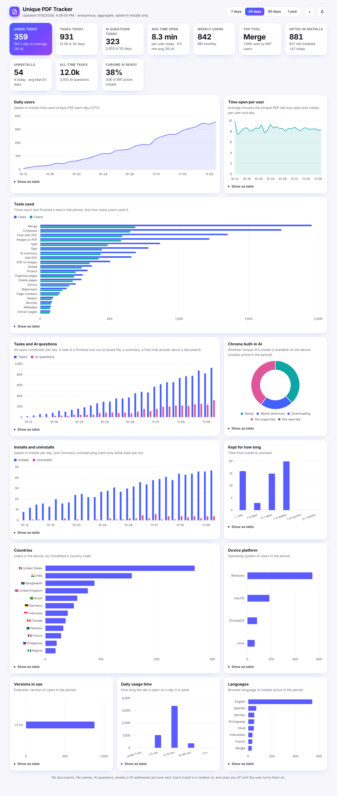

# Unique PDF tracker

A small Cloudflare Worker with a built-in dashboard that shows how Unique PDF is used, without
collecting personal data or anything about people's documents.

- **users** today, this week and this month
- **tools used**: how many times each tool finished a task, and by how many users
- **Unique AI questions** asked, per day
- **time open**: average minutes the Unique PDF tab is open and visible, per user per day
- **installs, updates, uninstalls**, how long people keep the extension, and versions in use
- **country** (Cloudflare's 2-letter code), **platform** (Windows, macOS, ChromeOS...), browser
  **language**, and whether **Chrome's built-in AI** is available on people's devices



*The screenshot shows generated sample data. The [dark theme](screenshots/dashboard-dark.png) follows the system setting or the ◑ button.*

It runs on Cloudflare's **free plan**: Workers (100,000 requests a day) and a **D1** database
(5 GB, 100,000 row writes a day). That covers several thousand daily users with stats turned on.

> **Opt-in only.** Usage stats are **off** in the extension until the user turns them on (Settings,
> or the one-time "Help improve Unique PDF?" card after their first finished task). Installs that
> never opt in send nothing, so the dashboard counts opted-in installs only. That is the promise in
> the published privacy policy (`PRIVACY.md`): no data collection without explicit opt-in.

---

## What the extension sends (and what it never sends)

| Event | When | Fields |
|---|---|---|
| `install` | when the user turns stats on (the first time) | random id, version, OS, language, Chrome AI status, install age in days, counts |
| `update` | the first time it is used after an update | the same, plus the previous version |
| `active` | once a day while Unique PDF is used | the same |
| `usage` | about every 30 minutes while there are new counts | counts only |
| uninstall | Chrome opens the uninstall URL (only set while stats are on) | random id, version |

The counts are the numbers since the previous report: tasks finished per tool (`t`, e.g.
`{"merge": 2}`), Unique AI questions (`q`) and minutes the app tab was open (`um`).

**Never sent:** documents or any of their content, file names, file sizes, page counts, passwords,
AI questions or answers, settings, history, names, emails or IP addresses. The id is a random number
the extension makes up when stats are turned on, and deletes when they are turned off. The country
comes from Cloudflare (from the connection). The Worker stores only the 2-letter code, never the IP.

What the database keeps:

| Table | One row per | Columns |
|---|---|---|
| `installs` | random install id | first / last seen, version, OS, language, country, Chrome AI status, uninstalled at, total tasks / AI questions |
| `daily` | install and day (UTC) | tasks, AI questions, minutes open, version, OS, country |
| `tool_daily` | day, tool and install | times the tool finished a task |
| `counts` | day and event | number of installs, updates and uninstalls |

Per-day rows are deleted after 400 days.

---

## Set it up in the Cloudflare dashboard (no terminal, about 5 minutes)

The extension (1.3.0) sends to **`https://unique-pdf.shahriarahmed614.workers.dev`**. That is a
Worker named **`unique-pdf`** on the same Cloudflare account as the GrowX tracker. Create it with
exactly that name and nothing in the extension has to change.

### 1. Create the Worker

1. Open [dash.cloudflare.com](https://dash.cloudflare.com) and sign in.
2. Go to **Compute (Workers) → Workers & Pages → Create → Create Worker**.
3. Name it **`unique-pdf`** and click **Deploy**. Check the URL it shows:
   `https://unique-pdf.shahriarahmed614.workers.dev`.

### 2. Create the database

1. Go to **Storage & Databases → D1 SQL Database → Create**.
2. Name it `unique-pdf-tracker`, leave the location on *Automatic*, click **Create**.

You don't need to run any SQL. The Worker creates its tables itself on the first request.

### 3. Put the code in the Worker

1. Open the **unique-pdf** Worker and click **Edit code**.
2. Select everything in the editor (`Ctrl+A` / `Cmd+A`) and delete it.
3. Copy the **whole** [`worker.js`](worker.js) from this folder, paste it, click **Deploy**.

### 4. Connect the database

1. In the Worker, open **Settings → Bindings → Add binding → D1 database**.
2. **Variable name:** `DB` (capital letters, exactly this). **Database:** `unique-pdf-tracker`.
3. Click **Add binding**.

### 5. Protect the dashboard with a password (recommended)

1. In the Worker's **Settings → Variables and Secrets**, click **Add**.
2. Type **Secret**, name `STATS_KEY`, value: a long password you choose. Click **Deploy**.

The dashboard asks for this key once and remembers it in that browser. Events from the extension
don't need it.

### 6. Open the dashboard

Go to **https://unique-pdf.shahriarahmed614.workers.dev**.

- **7 days / 30 days / 90 days / 1 year** at the top right.
- ◑ switches light and dark, ↻ refreshes (it also refreshes every 2 minutes).
- Every chart has **Show as table** with the exact numbers.

Numbers appear as soon as someone with version 1.3.0 or later turns on usage stats.

Check that it works: `https://unique-pdf.shahriarahmed614.workers.dev/health` shows `ok`.

---

## A different Worker name or account

The address is in two places in the extension. Change both, then rebuild (`npm run build`) and
re-package (`npm run package`):

- `src/services/telemetry/endpoint.ts` → `USAGE_STATS_ENDPOINT` (the manifest's `connect-src` is
  generated from it);
- `scripts/validate-build.mjs` → `TRACKER` (the build check that allows exactly this one host).

The unit tests fail if the two differ. Update the address in `PRIVACY.md` and the in-app Privacy
page (`src/app/pages/PrivacyPage.tsx`) too.

### With a terminal instead (optional)

```sh
cd tracker
cp wrangler.toml.example wrangler.toml
npx wrangler login
npx wrangler d1 create unique-pdf-tracker     # copy the database_id into wrangler.toml
npx wrangler deploy
npx wrangler secret put STATS_KEY             # optional
```

---

## API

| Method and path | What it does |
|---|---|
| `GET /` | the dashboard |
| `GET /api/stats?days=7\|30\|90\|365` | all the dashboard's numbers as JSON. With `STATS_KEY` set, send it as the `x-stats-key` header (or `?key=`) |
| `POST /e` | event intake used by the extension (max 4 KB, validated, unknown fields dropped) |
| `GET /u?id=&v=` | uninstall ping. Shows a short "Unique PDF was removed" page with feedback links |
| `GET /health` | `ok` |

Example: `curl -H "x-stats-key: YOUR_KEY" "https://unique-pdf.shahriarahmed614.workers.dev/api/stats?days=7"`

```json
{
  "today":  { "users": 120, "tasks": 410, "questions": 95, "uiAvg": 6.5, "installs": 14, "uninstalls": 1 },
  "totals": { "installs": 860, "active": 790, "uninstalled": 70, "tasks": 25000, "questions": 4100, "wau": 520, "mau": 790, "avgLifeDays": 12.4 },
  "range":  { "tasks": 9800, "questions": 2100, "installs": 300, "updates": 410, "uninstalls": 22, "avgUsers": 110, "uiAvg": 7.1 },
  "series": [{ "day": "2026-11-10", "users": 120, "tasks": 410, "questions": 95, "uiMin": 780, "installs": 14, "updates": 3, "uninstalls": 1 }],
  "tools":  [{ "k": "merge", "n": 2100, "users": 640 }],
  "countries": [{ "k": "US", "n": 140, "tasks": 3100 }],
  "platforms": [{ "k": "win", "n": 520 }],
  "versions":  [{ "k": "1.3.0", "n": 700 }],
  "ai":        [{ "k": "available", "n": 310 }]
}
```

---

## Troubleshooting

| You see | Fix |
|---|---|
| `No D1 database is attached` | Step 4: the binding must be a **D1 database** named exactly `DB`. |
| The dashboard asks for a key you don't know | Set a new `STATS_KEY` (step 5), then click **Forget key** at the bottom of the dashboard, or clear the site data. |
| Tiles show numbers but there are no charts | The charts load Chart.js from `cdnjs.cloudflare.com`; a blocker can stop that. **Show as table** still works. |
| Everything is 0 | Nobody has turned on usage stats in version 1.3.0+ yet, or the Worker's URL is not `https://unique-pdf.shahriarahmed614.workers.dev`. |
| `Error 1101` | The code wasn't pasted completely. Paste the whole `worker.js` again and deploy. |

Tests: `npx vitest run tests/unit/tracker.test.ts` runs this Worker against a real SQLite database.
